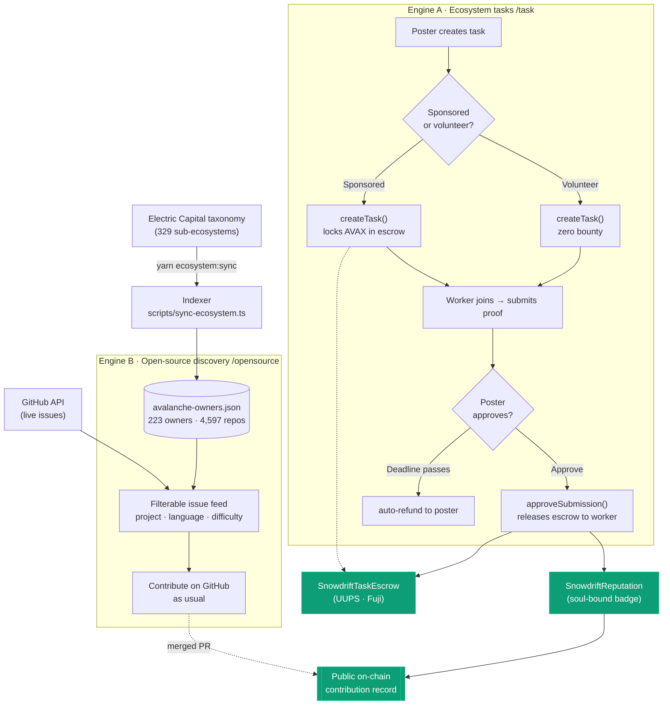

# Snowdrift

**A coordination layer for Avalanche ecosystem work — code and everything around it.**

[**Live build → snowdrift-aval.vercel.app**](https://snowdrift-aval.vercel.app) · Avalanche Fuji (chainId 43113) · [Contracts on Snowtrace](#deployed-contracts-avalanche-fuji-chainid-43113)

---

Avalanche has no standing coordination layer for ecosystem work. Projects that need contributors, teams running ambassador programs, and teams commissioning content each solve the same problem separately — in Discord threads and spreadsheets, with no shared record of who contributed what. Developers looking for a way in have nowhere to look.

Snowdrift closes that gap, and part of it is already closed. The discovery layer is **built, deployed, and running on real data**; the settlement contracts are **deployed and source-verified on Fuji**. It was built without funding.

## What it does

Snowdrift has two sides that share one task flow:

- **Open-source discovery.** A live index of contributor-ready work across the Avalanche ecosystem, sourced from the [Electric Capital ecosystem taxonomy](https://github.com/electric-capital/crypto-ecosystems) rather than a hand-picked repo list. The sync currently resolves **329 Avalanche sub-ecosystems, 223 repo owners and 4,597 repositories** straight from the taxonomy ([`scripts/sync-ecosystem.ts`](scripts/sync-ecosystem.ts) → [`data/avalanche-owners.json`](data/avalanche-owners.json)). Contributors filter by project, language and difficulty, then contribute on GitHub as usual.
- **Ecosystem task management.** Beyond code: ambassador programs, content, translation, events, design, moderation. **Volunteer tasks** need no payout and produce a verifiable contribution record. **Sponsored tasks** lock funds in a non-custodial escrow contract, released on approval. Both run the identical flow, so one system can run a content campaign, an ambassador program and a funded bug fix — with a public, on-chain record of who did what.

## How it fits together

Two engines share one task flow and one on-chain record. The discovery engine is fed by the ecosystem indexer; the task engine settles through the escrow and reputation contracts on Fuji. The two sides stay independent — separate auth, separate domains — and meet only at the shared contribution record.



## Why Avalanche

A $30 content task or a $50 issue reward cannot absorb multi-dollar settlement costs. Avalanche C-Chain's sub-second finality and low fees are the technical precondition for the entire model — micro-rewards only work where settlement is near-free. The platform charges **0% fee**; the chain is the point.

## Status

| Layer | State |
| --- | --- |
| Open-source discovery (indexer + filterable feed) | **Live** — running on the real Electric Capital taxonomy |
| Task interface (browse, create, volunteer + sponsored) | **Live** on the deployed site |
| Escrow + reputation contracts | **Deployed & source-verified on Fuji** (below) |
| Full sponsored flow on-chain (create → join → proof → release) | **Working on testnet**, driven by wagmi |
| Independent contract review | In progress (reviewer: Zintarh) |
| C-Chain mainnet deployment | Planned (post-review) |

## Deployed contracts (Avalanche Fuji, chainId 43113)

All three are source-verified on Snowtrace:

| Contract | Address |
| --- | --- |
| SnowdriftTaskEscrow (proxy, UUPS) | [`0xfa2FF5e050C02a899e8302fe2d78A646d4Ad124D`](https://testnet.snowtrace.io/address/0xfa2FF5e050C02a899e8302fe2d78A646d4Ad124D) |
| SnowdriftReputation (proxy, UUPS) | [`0x4742a10E05a4F82472ACCF3C369504fe3F39e4ED`](https://testnet.snowtrace.io/address/0x4742a10E05a4F82472ACCF3C369504fe3F39e4ED) |
| MockUSDC (ERC-20 test path) | [`0xD98553415f535586CfA273D6cD6710F39ef94A96`](https://testnet.snowtrace.io/address/0xD98553415f535586CfA273D6cD6710F39ef94A96) |

Both core contracts are **UUPS-upgradeable** (owner-gated upgrades, pause circuit-breaker), so mainnet fixes ship without redeploying or migrating escrowed funds. The escrow implements the full lifecycle on-chain — creation, join, proof submission, approval-with-payout, rejection, deadline expiry with automatic refund, and dispute hooks — and both native AVAX and ERC-20 settlement are covered by a Foundry test suite. The Solidity lives in a separate Foundry project (`snowdrift-foundry`).

## Stack

- **Frontend:** Next.js 16 (App Router) · React 19 · TypeScript · Tailwind CSS v4 (`@theme` tokens)
- **Web3:** Reown AppKit + wagmi + viem · shadcn-style primitives on the unified `radix-ui` package
- **Contracts:** Solidity, Foundry, UUPS-upgradeable, deployed to Avalanche Fuji
- **Indexer:** Node/TypeScript sync over the Electric Capital taxonomy → JSON, refreshed with `yarn ecosystem:sync`
- lucide-react · react-hook-form + zod · sonner

## Getting started

This project uses **Yarn 1 (Classic)** — no corepack, no `packageManager` pin; a normally installed Yarn works.

```bash
yarn install
cp .env.local.example .env.local   # then fill in the values below
yarn dev                           # http://localhost:3000
```

`.env.local` needs:

```
NEXT_PUBLIC_REOWN_PROJECT_ID=      # from https://dashboard.reown.com
NEXT_PUBLIC_TASK_ESCROW_ADDRESS=0xfa2FF5e050C02a899e8302fe2d78A646d4Ad124D
NEXT_PUBLIC_REPUTATION_ADDRESS=0x4742a10E05a4F82472ACCF3C369504fe3F39e4ED
NEXT_PUBLIC_MOCK_USDC_ADDRESS=0xD98553415f535586CfA273D6cD6710F39ef94A96
GITHUB_TOKEN=                      # a PAT raises the GitHub API rate limit for the indexer
```

The app won't start without the Reown project id and the contract addresses.

Refresh the ecosystem index at any time:

```bash
yarn ecosystem:sync
```

## Architecture

```
app/
  page.tsx                    Landing page
  (tasks)/                    TASKS dashboard — route group, no path segment
    layout.tsx                Tasks shell — sidebar with wallet connect
    task/
      page.tsx                Browse + filters (reads on-chain tasks)
      post/page.tsx           Post a task (RHF + zod, milestone builder, locks escrow)
      [id]/page.tsx           Task detail — accept → submit → approve → release
  opensource/                 OPEN-SOURCE dashboard
    layout.tsx                OSS shell — sidebar with GitHub connect
    page.tsx                  Discovery overview
    projects/page.tsx         Indexed Avalanche repositories
    issues/page.tsx           Contributor-ready issues (filterable)
    rewards/page.tsx          Contribution record
hooks/                        wagmi hooks for the escrow (one per file)
  escrow.ts · useChainTasks.ts · useCreateTask.ts · useJoinTask.ts · …
lib/
  tasks/                      Tasks domain — types + constants only
  opensource/                 OSS domain — indexer, GitHub + ecosystem layer
config/index.ts               wagmi/Reown adapter + address constants (from env)
context/ReownProvider.tsx     WagmiProvider + AppKit + react-query
components/
  landing/ · layout/ · tasks/ · wallet/ · github/ · ui/
scripts/sync-ecosystem.ts     Electric Capital taxonomy → data/avalanche-owners.json
data/avalanche-owners.json    Generated index (329 sub-ecosystems · 223 owners · 4,597 repos)
```

**Two independent dashboards.** `/task` connects a **wallet** (Reown); `/opensource` has a **GitHub connect** in its sidebar (currently a UI stub, ready for real OAuth — the issue *indexer* already uses the live GitHub API). Switching between them via the sidebar cross-link ends the current side's session, so the two never share auth state. `lib/tasks` and `lib/opensource` never import from each other — each route segment only touches its own domain.

**On-chain integration.** The tasks side reads and writes `SnowdriftTaskEscrow` through wagmi. `lib/tasks/data.ts` holds only types and constants; live data comes from the `hooks/` layer, which maps contract structs onto the UI `Task` type. Posting a task locks the bounty in escrow; the detail page drives the real accept → submit → approve → release flow with transaction confirmations.

## What the grant funds

The discovery layer and task interface exist. Grant funding takes the **settlement layer** from verified-on-Fuji to production:

- independent contract review + a public testnet bug-bounty window, then **C-Chain mainnet** deployment
- GitHub-to-wallet identity linking and merged-PR verification for sponsored issue tasks
- indexer scale-up (incremental sync, caching, rate-limit handling) and onboarding of the first Avalanche teams posting real tasks

Every target is countable from public chain data — unique contributor wallets, tasks created vs. settled, escrow volume, and poster/worker concentration — so progress is verifiable, not self-reported.

## Links

- **Live app:** https://snowdrift-aval.vercel.app
- **Escrow contract:** https://testnet.snowtrace.io/address/0xfa2FF5e050C02a899e8302fe2d78A646d4Ad124D
- **Reputation contract:** https://testnet.snowtrace.io/address/0x4742a10E05a4F82472ACCF3C369504fe3F39e4ED
- **Electric Capital taxonomy:** https://github.com/electric-capital/crypto-ecosystems

## Design

Teal accents (`#14c490` / `#0d9e75`) on green-tinted near-black surfaces. Fonts: Syne (display), DM Sans (body), DM Mono (numbers/addresses). All tokens live in `app/globals.css` under `@theme`.

---

Built by [Phoebe (Ifeoluwa Sanni)](https://github.com/pheobeayo) · [ifeoluwaayosanni.vercel.app](https://ifeoluwaayosanni.vercel.app)
